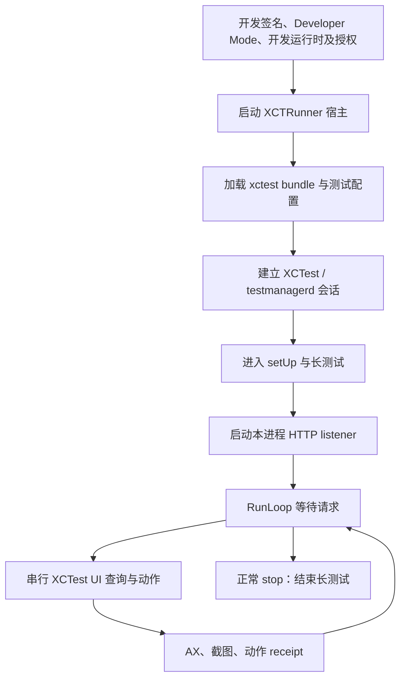
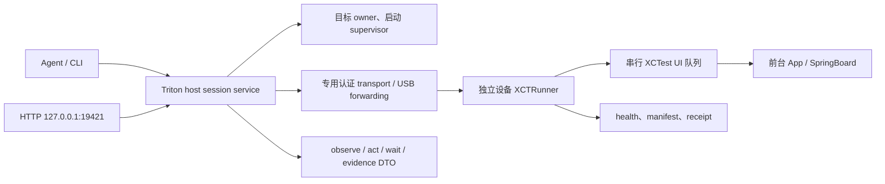

# iOS 设备端常驻 XCUITest Runner：机制与 TritonKit 接入研究

研究日期：2026-10-14。对应 [SP-193](./README.md)。本期已完成固定源码研究、独立 PoC、Simulator 与有线 iPhone 的标准 XCTest 长测试。详细实测见 [实验报告](./plans/20261014-lab-results.md)。尚未证明无宿主冷启动、锁屏存活或永久常驻。

## 结论

建议把常驻 Runner 做成独立、可选的 `xcuitest-runner` host provider。第一阶段由 Mac 启动和管理 XCTest 会话，复用 TritonKit 的观察、动作、等待、证据 DTO；先验证健康、AX、截图，再加入一个公开 XCTest tap 和后置断言。预装启动、断开 Mac 后运行及手机端准备 DDI 分阶段研究。

核心价值是：设备上独立测试进程可以观察和操作前台 App 及系统 UI，不要求被测 App 嵌入 TritonKit。它仍无法替代 embedded runtime 的路由、业务状态、网络事件和应用内部语义。

源码证实的是“长时间不返回的 XCTest + 本进程服务”，不能据此承诺永久后台、开机自启或无前置准备。HTTP 就绪、XCTest 就绪、动作送达、业务成功必须分别证明。

## 固定研究基线

| 对象 | 基线 | 用途 |
| --- | --- | --- |
| iCTRL | [`99dbfecdb39836ba26a0b2b0dcfde90f705a6835`](https://github.com/OpenMinis/iCTRL/tree/99dbfecdb39836ba26a0b2b0dcfde90f705a6835) | 自启动包装、长测试及 UI 服务 |
| Appium WebDriverAgent | [`e7e2665a00633dc174d7fc579f7e606bc9ba782a`](https://github.com/appium/WebDriverAgent/tree/e7e2665a00633dc174d7fc579f7e606bc9ba782a) | 独立验证长测试服务模式 |
| Appium XCUITest Driver | [`1be253af959bbd29427166a910a78a38fdd66185`](https://github.com/appium/appium-xcuitest-driver/tree/1be253af959bbd29427166a910a78a38fdd66185)，package version 12.18.1 | 预装 WDA 启动方式与版本边界 |
| TritonKit | `main@8aaf6c31d308194b489e10ed83362cee91f549d5` | 当前接入能力与缺口 |
| 已安装 CLI | `triton 0.2.26` | 只读事实采集，不替代当前源码或 Runner 验证 |

本报告标注“源码事实”“上游说明”“方案建议”和“待实测”，避免将其中一种证据外推为产品支持承诺。

## 运行链路

这是一张逻辑关系图，不表示每个 OS 都以同样的私有调用顺序实现。控制权来自 XCTest 自动化会话及系统测试服务；监听端口、URL scheme 或 Mach-O shim 本身都不授予 UI 控制权。

### 构建、打包与签名

源码事实：iCTRL 的 `bundle.ui-testing` target 经 `xcodebuild build-for-testing` 生成 Apple XCTRunner 宿主和 `.xctest` 插件。主 SwiftUI App 与 Runner 分离。[project.yml](https://github.com/OpenMinis/iCTRL/blob/99dbfecdb39836ba26a0b2b0dcfde90f705a6835/project.yml#L56-L90)、[Makefile](https://github.com/OpenMinis/iCTRL/blob/99dbfecdb39836ba26a0b2b0dcfde90f705a6835/Makefile#L40-L46)

包装阶段有三种不同目的，不能合并成“修改后自动获得权限”：

1. 修改 `.xctest` 的 bundle ID，再执行嵌套签名；它影响插件加载和重签名兼容性，不足以解释测试配置发现。需单变量 A/B 验证实际因果。[签名脚本](https://github.com/OpenMinis/iCTRL/blob/99dbfecdb39836ba26a0b2b0dcfde90f705a6835/Scripts/sign-ipa.sh#L214-L239)
2. 去掉开发机带入的 XCTest/XCUIAutomation 等副本，使用设备的开发运行时；依赖 DDI 与 OS 兼容性。安装成功仍可能在加载测试库时失败。[构建清理](https://github.com/OpenMinis/iCTRL/blob/99dbfecdb39836ba26a0b2b0dcfde90f705a6835/Makefile#L81-L90)
3. 为旧运行时缺少的 `XCTCommandLineToolHelper` 导入添加 shim，再重定向 dyld bind/nlist ordinal。实际脚本尾部追加 dylib load command，不是注释所称“提前加载抢符号”；shim 也不实现 XCTest 会话。[重定向步骤](https://github.com/OpenMinis/iCTRL/blob/99dbfecdb39836ba26a0b2b0dcfde90f705a6835/Makefile#L115-L127)、[insert-dylib.py](https://github.com/OpenMinis/iCTRL/blob/99dbfecdb39836ba26a0b2b0dcfde90f705a6835/Scripts/insert-dylib.py#L62-L74)

TritonKit 第一阶段应使用标准 XCTest 工程及开发签名，不先复制这些兼容补丁。只有固定版本复现问题后，才引入有单独测试的最小适配。

### 冷启动的证据缺口

上游说明允许点 Runner 图标启动。管理 App 的实际操作只是打开 `ictrl://start`；早期 URL hook 包装 Apple `_XCTRunnerAppDelegate`，继续调用原 delegate。主 App 不是 UI 自动化执行者，DDI 已准备时可以不安装它。[SettingsView](https://github.com/OpenMinis/iCTRL/blob/99dbfecdb39836ba26a0b2b0dcfde90f705a6835/iCTRLApp/Views/SettingsView.swift#L350-L356)、[EarlyURLHook](https://github.com/OpenMinis/iCTRL/blob/99dbfecdb39836ba26a0b2b0dcfde90f705a6835/iCTRLUITests/EarlyURLHook.m#L120-L138)、[上游安装说明](https://github.com/OpenMinis/iCTRL/blob/99dbfecdb39836ba26a0b2b0dcfde90f705a6835/README.md#L253-L260)

仓库没有 XCTRunner stub 源码、显式生成的 `.xctestconfiguration`/`.xctestrun`，也没有自己构造 `XCTestConfiguration`。因此“点图标 → 测试配置/发现 → XCTest bootstrap”仍依赖 Apple 闭源 Runner，无法由仓库代码独立证明。此前由 Xcode 启动过的会话、预装后独立启动、完全没有 Mac 准备是三种不同实验条件。

`setUp` 没到也不代表 bootstrap 没启动：它可能正等待 Enable UI Automation 授权。iCTRL 曾因重复 bootstrap 触发共享服务重复注册而 SIGABRT；当前进程内 re-kick 已禁用，旧 retry 注释不能作为恢复机制证据。[诊断记录](https://github.com/OpenMinis/iCTRL/blob/99dbfecdb39836ba26a0b2b0dcfde90f705a6835/iCTRLUITests/EarlyURLHook.m#L240-L258)、[当前 no-op 实现](https://github.com/OpenMinis/iCTRL/blob/99dbfecdb39836ba26a0b2b0dcfde90f705a6835/iCTRLUITests/EarlyURLHook.m#L386-L398)

### 长测试如何提供服务

源码事实：`setUp` 降低测试失败中断影响；`testStartServer` 建立 listener，随后循环执行默认 RunLoop。两秒 timer 处理早期 URL，`stop` 改变 `keepRunning` 后返回测试。没有持续忙等来模拟 daemon。[iCTRLUITests.swift](https://github.com/OpenMinis/iCTRL/blob/99dbfecdb39836ba26a0b2b0dcfde90f705a6835/iCTRLUITests/iCTRLUITests.swift#L423-L505)

WebDriverAgent 同样在测试方法里启动 WebServer，并在主 RunLoop 中等待服务停止。这给出了独立实现的交叉证据；它不证明任意冷启动或无限后台存活。[WDA 测试入口](https://github.com/appium/WebDriverAgent/blob/e7e2665a00633dc174d7fc579f7e606bc9ba782a/WebDriverAgentRunner/UITestingUITests.m)、[WDA 服务循环](https://github.com/appium/WebDriverAgent/blob/e7e2665a00633dc174d7fc579f7e606bc9ba782a/WebDriverAgentLib/Routing/FBWebServer.m#L56-L69)

UI RPC 进入串行队列，健康等请求可以独立响应。但 listener 可达时，XCTest 授权、AX 会话或 UI 队列仍可能不可用；必须设置 `automationReady` 与有界 probe。[iCTRL HTTP 分发](https://github.com/OpenMinis/iCTRL/blob/99dbfecdb39836ba26a0b2b0dcfde90f705a6835/iCTRLUITests/iCTRLUITests.swift#L983-L1068)、[就绪检查](https://github.com/OpenMinis/iCTRL/blob/99dbfecdb39836ba26a0b2b0dcfde90f705a6835/iCTRLUITests/iCTRLUITests.swift#L520-L610)

## 常驻的实际边界

| 条件 | 能证明的事实 | TritonKit 应如何处理 |
| --- | --- | --- |
| HTTP 健康通过 | 网络线程及进程部分可用 | 不直接广告 UI action；单独测试自动化会话 |
| Runner 后台 | iCTRL 尝试私有 `UIApplication.suspend`，先检查系统 UI | 记录前后台状态；失败留前台，不能误报后台常驻 |
| 设备锁屏 | 上游称休眠可运行，但 AX/动作各自受限 | 分别测 health、截图、AX、写动作；wake 不等于密码解锁 |
| 测试超时 | XCTest 可按 test plan/启动参数限制长测试 | 明确测试 allowance 与 host session TTL，不能依靠未知默认值 |
| UI 请求超时 | host 不再等待；底层 XCTest 可能仍运行 | 写动作返回 outcome unknown，不自动重试/换 provider 补点 |
| 本地 reset | iCTRL 清 refs、几何、PID、lastSeen 缓存 | 不能称为重建 testmanagerd/AX 会话 |
| 进程崩溃/被杀 | RunLoop 和吞 issue 无法保护进程 | owner supervisor 外部重启；新 session 使旧 refs/receipt 失效 |
| 设备重启 | 开发运行时及授权需重新检查 | 不承诺开机自启；按 OS 验证 DDI 重新准备要求 |
| Mac/USB 断开 | 当前会话能否继续尚无本轮证据 | 区分原会话存活、网络重连及新会话冷启动 |

Apple 对普通 App 的后台说明是：进入后台后通常会被挂起，有限后台任务不构成永久运行保证。该文档不能直接证明 XCTest Runner 必定被挂起，但提醒不能用 RunLoop 推导系统保活；需记录测试会话/进程与真实连续探测结果。[后台执行](https://developer.apple.com/documentation/uikit/about-the-background-execution-sequence)

`executionTimeAllowance` 默认 600 秒，但只有启用测试超时后才生效；test plan 或 xcodebuild 的 maximum allowance 可以再限制。不能笼统断言“所有 Runner 十分钟必停”，也不能承诺无限运行。[XCTest 官方说明](https://developer.apple.com/documentation/xctest/xctestcase/executiontimeallowance)

Developer Mode 与开发签名是设备准备条件；首次启用仍涉及用户重启/确认及密码。TritonKit 的 transport token 与 Apple 开发配对不是同一种授权。[Apple Developer Mode](https://developer.apple.com/documentation/xcode/enabling-developer-mode-on-a-device)

### 启动方式必须按版本验收

Appium 固定版本文档将预装 WDA 现代路线限定于 iOS/tvOS 17、watchOS 10 起。它通过 RemoteXPC/CoreDevice 启动；iOS/tvOS 27 起禁用 `devicectl` fallback，因为该路径不能使 Runner 后台启动 HTTP。17–26 的 fallback 也不能外推为 TritonKit 已验证能力。[固定版官方指南](https://github.com/appium/appium-xcuitest-driver/blob/1be253af959bbd29427166a910a78a38fdd66185/docs/guides/run-preinstalled-wda.md)

这一证据来自上游说明，不是本轮设备测量。不能把普通 `triton app launch` 成功当作 Runner 就绪，也不能直接采用 iCTRL 的 iOS 16+ 声明作为支持矩阵。标准 XCTest 启动与预装启动需要独立版本表。

## TritonKit 当前可复用的部分与缺口

以下均为基线源码事实，路径相对仓库根目录。

| 面 | 当前实现 | 接入判断 |
| --- | --- | --- |
| device identity | `CLIHostModels.swift` 的 `HostDeviceTarget` 分离 public/raw identity；`CLIHostDeviceRuntime.swift` 保留派发 aliases | 复用精确目标与公开输出脱敏；增加 Runner session identity |
| host intent | `TKHostAdapterModels.swift` 的 `TKHostCommand` 有超时、风险、artifact | 复用审计描述；常驻 supervisor 必须新增 |
| specialized Runner | `CLIHostApplePlatformRunnerRuntime.swift:61–102` 仅 watchOS/tvOS 特定动作、Simulator UDID | nonce/精确绑定可借鉴，不能直接视为通用 iOS 真机 Runner |
| process runner | `CLIHostApplePlatformRunnerProcess.swift` 等测试结束、解析 xcresult | 一次性执行生命周期不适用于长测试服务 |
| observation | `CLIObservationModels.swift` 的来源、nodes、partial、artifact | DTO 可复用，新增来源 `xcuitest-runner` 和 provider dispatch |
| HTTP | `CLIServeCommand.swift:929–957` `/request` 转发 embedded TKMessage | 保持 host HTTP 入口；不能把它当已有任意 Runner RPC transport |
| runtime HTTP | `CLIRuntimeTransportClient.swift` 固定 embedded routes | 新建 Runner client，不能将 Runner URL 塞进 runtimeBaseURL |
| USB forwarding | `CLIWebDeviceRuntime.swift:288–297` 仅探测 iproxy executable | 转发启动、身份握手、进程回收均未实现 |
| target lease | `CLITargetLeaseGate.swift:6–11` 仅显式 `--lease` 才检查；identity normalization 主要针对模拟器 | 真机 canonical key、Runner 强制 owner 与串行调度需要新增 |
| evidence | `TKEvidenceModels.swift` 支持 source/scope/freshness/redactionStatus/metadata | 复用容器，增加 capture provider；现有真机缺项继续报告 skipped |
| SDK 边界 | 根 SwiftPM 无 Runner 依赖；Release runtime disabled | Runner 独立工程/产物，XCTest及私有依赖不得进入 embedded 包 |

## 接入方案建议（尚未实现）

建议状态机：`absent → preparing → launching → listening → automationReady → serving → stopping → stopped`，任何阶段可以转 `failed/disconnected`。锁屏、前台与 action capability 是独立状态，不强行塞入单个 ready boolean。所有新名字和命令面均为 proposed，当前 CLI 没有这些能力。

### session、身份与通信

- handshake 绑定 `deviceID + runnerBundleID + buildID + sessionID + protocolVersion + nonce`；回包验证后才注册 provider。
- host 生成 session secret，通过受控启动渠道传入；日志/schema/evidence 不打印 secret。USB forwarding 的 loopback 不能代替认证。
- 使用现有 host HTTP 的固定端口；设备 listener/forwarder 使用独立受控端点。最初不开放直接 LAN 产品面。若后续允许 LAN，另做 TLS/配对设计，不复制 iCTRL 自定义加密。
- readiness 至少区分 transport、testSession、automationProbe、UIQueue 与每项 capability。被锁设备可报告 health ready、UI unavailable。
- mutation 必须持有当前设备 session owner，目标和 App/frontmost binding 在执行前再次校验；观察与动作都串行进入 XCTest，避免共享会话抢占。
- UI request 有 requestID、deadline 和响应体/节点预算。deadline 不等于底层取消；已发送写动作超时后只查询同 session receipt，禁止默认重发。
- ref 绑定 session、snapshot generation、App/scene、采集时间；页面变更/Runner 重启时失效。执行前 re-resolve，歧义或 stale 失败，不使用旧坐标静默补救。
- 长测试正常 stop 结束，并回收本任务拥有的 forwarding/test 进程。重启后生成新 session，不杀其他任务的 xcodebuild。

### 观察、动作与证据

初始端点仅 `health / manifest / snapshot / screenshot / stop`。AX 收集端必须限制 nodes、depth、耗时与 payload；截断报告 partial 和原因，不能仅裁剪输出。health 不排队等待可能卡死的 UI 查询。

第二切片增加公开 `XCUIElement.tap`、fresh ref 与显式期望文本/状态。动作 receipt 区分 `submitted / delivered / postconditionVerified`；tap 返回只证明交互阶段，业务结果仍需后置条件。跨 App 和系统 UI 另列 capability，不宣称所有第三方 UI 或锁屏都可控。

证据记录 Runner build、OS/Xcode build、launch mode、target/session、timestamp、source、freshness、truncation 和 receipt；公开文件脱敏原始设备身份、证书、token及用户 UI 数据。关闭 XCTest 默认长录屏可避免长测试积累诊断资源，但应另有有界截图/AX/evidence，不能因此失去失败证据。

### 失败契约

复用单一 JSON envelope，以及已有 `target_not_found / ambiguous_target / target_offline / target_lease_conflict / unsupported_capability`。建议新增 Runner 的 launch、transport、authentication、protocol mismatch、target mismatch、expired session、stale ref、unknown outcome 错误。确有证据时才分类 Developer Mode/DDI/signing；泛化 bootstrap 失败不能猜测具体前置条件。

恢复建议遵循证据：transport 断开先验证同 session；UI 会话不可用由外部 owner 重启；action unknown 先查 receipt及后置状态；需要设备授权时明确等待人工操作。不能把 cache reset 返回成功称为会话修复。

## 分阶段裁决

| 阶段 | 范围 | 退出门禁 |
| --- | --- | --- |
| P0A | Mac 管理的独立长测试；只读 session/AX/截图；专用 transport | 真实设备握手、身份匹配、有界采集、停止与失败恢复；Simulator 只作协议预验证 |
| P0B | 一个公开 XCTest tap + 业务后置断言 | 送达和业务结果分开；超时不重复写；ref/owner/receipt 失效测试 |
| P1 | 预装 Runner 冷启动、后台、锁屏、断 USB、重连 | 按 OS/Xcode/启动模式实测矩阵，不承诺无条件常驻 |
| P2 | 手机端 DDI 准备及无 Mac 运行路线 | 独立评估签名/配对/权限/版本兼容，保留可诊断失败 |

私有事件合成、Mach-O shim、进程内 bootstrap、手机 DDI 自挂载不进入 P0。若要尽快建立可行性对照，可先用固定版 WDA 做研究基准；是否依赖 WDA 或开发轻量 Runner，应在同设备比较启动、AX、动作、资源和恢复后决定，不凭代码量推断性能。

## 本轮验证与证据边界

已保存 `triton version/status/doctor/capabilities/schema xcode/plan --json` 的私有原始输出于 ignored `.build/sp192-research-facts/`，均 exit 0、输出为合法 JSON。这里只记录命令收据与版本，不公开设备身份；这些事实证明当前 CLI 可读状态，不证明 resident Runner 可用。

源码核对覆盖长测试服务、冷启动包装、失效恢复与 Triton 接入缺口。独立公开 API PoC 已完成 Simulator 和真机标准 XCTest：UI 查询、截图、点击后置断言、去重、连续 health 和正常 stop。Runner 自报后台状态得到验证；首期 Home 后 fixture 仍前台，不能由此外推切换 App；追加多 App 实验通过 Calculator、Settings 与 fixture 的切换和部分真实动作。普通 app launch 未恢复服务；锁屏、断 USB、重启和 30 分钟资源曲线仍待测。详见 [实测报告](./plans/20261014-lab-results.md) 与 [后续计划](./plans/validation.md)。

## 补充：三种启动机制不能混用

1. 标准 Xcode XCTest：安装签名 Runner 和测试插件，建立 testmanagerd 会话，由测试配置选择 `testServe`。本轮 Simulator 和真机成功属于这条路径。
2. Appium `usePreinstalledWDA`：固定 driver 的 [wda-host-ops.ts](https://github.com/appium/appium-xcuitest-driver/blob/1be253af959bbd29427166a910a78a38fdd66185/lib/device/wda-host-ops.ts#L148-L191) 在启动 Runner 时指定 `ActivateSuspended`，并传业务环境。仅启动 Apple Runner 的配置发现仍有黑盒；不能照搬为普通 app launch 一定启动测试。
3. 通用 RemoteXPC `runXCTest`：固定 [xcuitest.ts](https://github.com/appium/appium-ios/blob/0cfd61aab2961eb3d82eef771b834948e5e61774/packages/remotexpc/src/services/ios/testmanagerd/xcuitest.ts#L129-L200) 明确构造 NSKeyedArchive XCTestConfiguration，由 runner-ready 回调返回；另有 PID 授权与 start-test-plan。配置经消息传递，不能把空 `XCTestConfigurationFilePath` 理解为无配置。

RemoteXPC 固定 npm `@appium/remotexpc@5.25.0` 的 gitHead 为 `0cfd61aab2961eb3d82eef771b834948e5e61774`，源码已位于 `appium/appium-ios/packages/remotexpc`。本轮未执行这条启动路径，仍是源码证据。`ActivateSuspended` 是 DVT 选项，本机 `simctl launch --help` 未给出同名可用 CLI flag，不凭内部选项杜撰命令。

## 补充：多 App 实际操作与失败边界

追加真机实验通过 Calculator 7+8=15、重复 Equals 请求去重、Settings 滚动进入 General 后返回、fixture AX 计数保留。最后长测试 179.109s / exit0 / 零失败。Safari 可激活并读取地址栏，固定导航在地址栏 tap 后被焦点校验拒绝；未清空、输入或验证网页。全屏截图的 app 元数据不等于画面归属，最后标记 fixture 的 PNG 实际为 App Switcher。完整通过项和三次旧失败见 [多 App 报告](./plans/20261014-cross-app-results.md) 与 [机器摘要](./plans/20261014-cross-app-summary.json)。

公开 API 跨进程控制可行，但需要完整元素类型、页面变化后的重新定位、unknown receipt 查询、独立业务后置断言与截图核对。52 条离线测试和单次 XCTest PASS 不替代所有业务场景通过；当前结果不证明永久常驻或任意第三方 App 控制。
