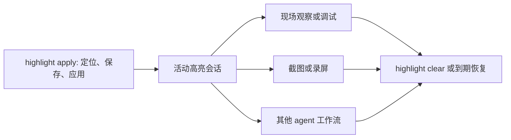

# 独立视图高亮能力：产品与实施计划

> 2026-10-14，按用户“定位节点 → 保存原属性 → 应用高亮是独立功能”修订。新增命令尚未实现。

跨端适配与恢复模式见[技术调研与裁决](./20261014-cross-platform-research.md)；本文直接border修改限定iOS P0。

## 可选接入

高亮属于按需增强，不强制接入内置SDK。普通节点查看/操作/截图沿用现有能力；按目标探测可写provider，可来自用户已有调试能力、自定义适配或可选Debug模块。显式apply不支持则返回unsupported；截图组合默认prefer，零写入的unsupported继续普通截图并标明未高亮，显式required才要求高亮成功。部分写入/恢复冲突始终显式报告。详见[技术调研接入边界](./20261014-cross-platform-research.md)。

## 功能边界

详细身份、快照和还原策略见 [标记与还原契约 v1](./20261014-mark-restore-contract.md)。

高亮能力自身完成：定位目标、保存原值、应用临时外观、返回活动会话。调用方随后可以现场观察、录屏、截图、排查布局，最后显式恢复；截图不属于高亮成功条件。

提供三个同等优先的公开操作：apply、status、clear。会话由 App runtime 持有，apply 命令正常结束后继续生效，后续 CLI/HTTP 请求通过 sessionID 访问。到期自动恢复是兜底；不是每次请求结束就恢复。

默认 outline 预设修改 `layer.borderColor = #FF453A`、`layer.borderWidth = 3pt`，保持布局、文本和交互属性不变；P0 只实现 outline，background 预设后置并单独设计恢复组。先支持 1–10 个节点，编号/箭头后置。同名元素必须消歧，不能默认选首项。

## 独立使用入口

```sh
# 拟议：应用后返回 sessionID、节点、修改摘要、渲染状态和到期时间
triton highlight apply --target <runtime-id> --spec highlights.json --ttl 30 --json

# 拟议：跨命令查询、显式恢复；截图不是必选步骤
triton highlight status --target <runtime-id> --session <session-id> --json
triton highlight clear --target <runtime-id> --session <session-id> --json

# 拟议：只还原指定标记，其余继续高亮
triton highlight clear --target <runtime-id> --session <session-id> --mark submit-button --json
```

```json
{
  "schemaVersion": 1,
  "preset": "outline",
  "items": [
    {
      "markID": "submit-button",
      "selector": {"identifier": "submit"},
      "label": "提交按钮"
    }
  ]
}
```

P0 selector支持当前runtime OID或唯一identifier，可选withinOID；text/role是保留字段、此UIKit provider拒绝。nodeRef/alias与语义selector属于后续provider，不能将草案能力当作当前已支持。operationID 由 CLI 产生或调用方显式指定，作为重试幂等和响应丢失后的查询依据；status 支持 sessionID 或 operationID 二选一。

独立 apply 不创建截图/证据目录。apply 成功返回 active 会话；status 成功只表示查询成功，消费者仍须检查 state；clear 成功必须是恢复完成并回读，不能仅意味着已收到请求。高亮呈现需有界渲染等待，但属性应用和 render-ready 不证明所有像素无遮挡。

## 消费方如何组合



截图汇报可以自己按以下顺序编排：未高亮原图 → apply → 截图 → clear → 记录。未来 `evidence capture --highlight highlights.json` 只是这一流程的便捷封装，复用同一公开契约；不能在 evidence 内另写一套高亮逻辑。

普通 screenshot/observe 不负责 clear。调用者手工创建的会话，即使截图失败也继续保持到显式 clear/到期；evidence 只清理自己创建的 session，在失败/取消时执行 finally 清理。MVP evidence 若遇到已有活动会话返回 busy，不借用后擅自清理别人的会话。

已高亮组合报告的完整成功要求截图和恢复均成功；prefer零写入unsupported时继续普通截图，报告未高亮；独立 apply 的成功不等待 clear。两者验收分离。高亮态截图标为 temporaryAppMutation，不能当未修改 UI 的视觉基准。

实施任务/文件分工/门禁统一见[执行清单](./20261014-execution-checklist.md)。

## 分期

| 阶段 | 交付 | 完成门槛 |
| --- | --- | --- |
| P0：独立高亮 MVP | public highlight apply/status/clear、shared DTO、HTTP request 透传、runtime 快照/恢复/TTL、capabilities/schema、公用 skill | 不调用 screenshot 也能独立验收；CLI 退出后会话持续，跨请求查询/恢复、冲突/过期/幂等和真实 UIKit 可见效果通过 |
| P1：截图消费方 | evidence --highlight、原图/高亮图/receipt、异常清理 | 只组合 P0；截图/恢复分别记录，明确会话所有权，host/embedded 来源分别验收 |
| P2：表达与平台 | 更多样式/徽标、更多 embedded provider、明确需求下的续期/多会话 | 每项独立能力声明与真实验收，host-only 不承诺写入 |

P0 可独立交付，不等待 evidence。底层保存/应用/恢复机制可供其他受限临时属性功能复用；本期不扩成任意 KVC/eval 或通用脚本执行器。

## 生命周期和并发

- runtime TTL 建议默认 30s，范围 1–300s，以适应跨命令观察；MVP 无永久会话、无自动续期。evidence 可显式选较短期限。deadline 使用单调时钟，重试不能延期。
- apply 正常退出、连接关闭均不代表 clear；否则独立 CLI 无法使用。runtime 通过 deadline/显式 clear/对象失效清理。响应丢失后先 status(operationID)，不重新应用。
- 取消发生在 apply 完成前时尝试取消/清理该 operation；若结果不可确认返回 unknown 和 operationID，后续可查。成功 apply 后的下游取消由其编排者决定是否 clear。
- 应用/恢复短临界区串行；活动会话不长期锁死所有输入。保护被覆盖字段，重叠 patch 返回 conflict；不相关只读/动作可继续。Triton 发起会改变目标页面身份的动作前，先清理或明确使会话失效；App 自身变化通过状态/生命周期检查检测，不能承诺所有复用实时可辨。
- 恢复以 border 组为单位，业务改了组中一项则整组不写并报 conflict/可能残留；MainActor 卡住/挂起时不能硬实时恢复，状态 pending/unknown，恢复运行后优先清理。
- 首期可选provider原型使用自愿启用 Debug runtime 的 UIKit 对象；缺可靠 contentEpoch 的 cell 子树拒绝，系统 UI、host AX/OCR-only、Release 不支持。

## 实施和验证

主控先定公用 DTO、session 所有权及状态机，再按 runtime/UIKit、CLI/schema/HTTP 和 evidence adapter 分配文件；同文件唯一 owner，共享构建/设备动作串行。

先写独立 apply/status/clear 的失败用例，再实现；验证至少包括不调用截图、正常退出连接、另一请求查询/清理、nil/动态色、多节点全量预检、TTL、业务冲突、复用失效、幂等、下游失败不自动 clear、evidence 不清理非自有会话。

门禁覆盖 focused contract、CLI、真实 UIKit destination、完整 CLI/根包、verify --local、真实可见高亮与恢复回读、docs/public skills/memory；宏条件跳过不算 UIKit 通过。本轮只规划，不声称功能已实现。
