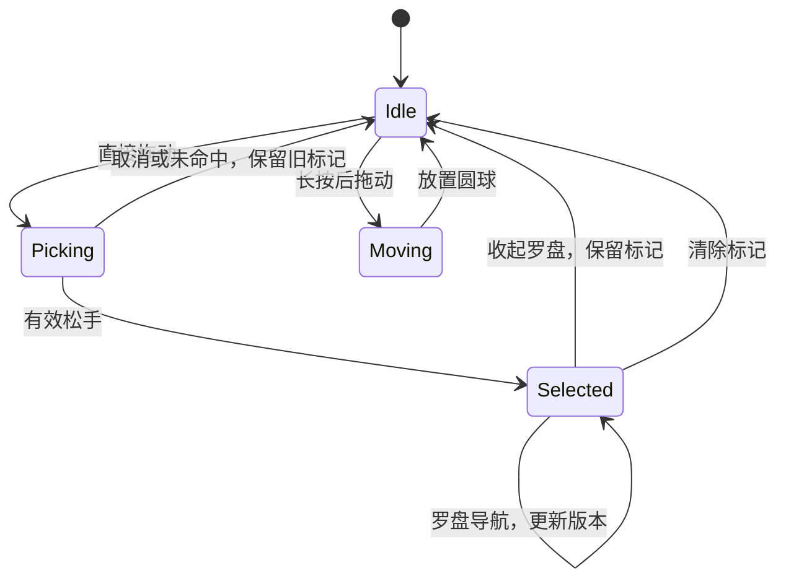

# SP-201 — SDK 悬浮圆点与控件选择

## 当前状态（2026-10-16）

- iOS UIKit 首版与用户试用后的交互优化已实现、验证并安装专用模拟器。功能提交 `2711565f` 已按用户授权整合到本地 `main`；保留独立worktree和主工作区其他任务WIP，待用户体验验收，未推送发布。
- 工作区：`../TritonKit-worktrees/SP-201-sdk-floating-picker`，实现基线 `dd613a99`。影响 embedded SDK、shared DTO、CLI 与现有本地 HTTP/runtime 转发；Web/Wails 无新写控制面。
- 用户需求：内置 SDK 悬浮圆点拖选并标记控件，供 agent 操作。先调研与交互设计，随后用户授权实现、测试、安装，并逐轮修订手势、实时反馈、方向罗盘与遮挡体验。
- 首版仅支持 Debug UIKit 可映射节点。SwiftUI 虚拟节点、WebView DOM、Android/Harmony provider 不在本次范围。

## 当前交互

1. 同时启用 `.inspector` feature 与 `picker.enabled` 后显示44pt圆点；默认关闭，Release无浮层、采集或响应。
2. 直接拖动：圆球变为透明十字准星并跟手，命中控件实时高亮，显示名称和局部2倍放大镜；候选变化轻反馈，松手前不提交标记。
3. 密集区域停留至少0.25秒、位移不超过12pt后显示临时辅助框；移动离开、结束、取消均清理。辅助层不修改业务view/layer。
4. 松手选中：保留轮廓与编号，圆球归位，自动展开方向罗盘。取消或未命中不创建新标记，保留之前仍有效的标记。
5. 罗盘上父级、下子级、左前同级、右后同级；方向代表节点关系，同级按subviews顺序。导航连续展开，返回子级优先回到上次节点，无有效记忆则选首个可选子节点。
6. 罗盘优先保持位置，有明显遮挡改善或越界时才重新放置；满屏容器只能最小化遮挡。中心收起保留标记，清除按钮独立；点圆球再次展开。
7. 长按0.4秒后拖动仅移动入口。圆点/罗盘按钮之外透明区域透传，拾取过程不向业务控件发送触摸事件。
8. agent读取当前selection后用同一快照的runtimeInstanceID、selection.id、selection.revision发起guarded tap，再验证业务结果。标记不自动执行点击或创建agent任务。

## BDD 与验收边界

| Given / When | Then |
| --- | --- |
| Debug显式双重启用 | 显示安全区内入口；不抢key window或业务first responder |
| 直接拖到按钮、经过控件或移出 | 实时准星/目标框/名称/放大镜；松手前无selection提交，移出清预览 |
| 拖动结束或取消 | 清空放大图像与辅助框；有效选择自动展开罗盘；业务点击为0 |
| 同点命中文字/按钮/容器 | 显示真实类名，显式导航；不将UIButtonLabel静默晋升为UIButton |
| 父级再返回子级 | 恢复刚才节点；隐藏/离树/身份变化/遮挡记忆回退，直接重选/clear清空路径 |
| 罗盘连续操作 | 无遮挡保持位置；禁用不可达方向；切换成功更新revision，菜单不消失 |
| 圆点/菜单之外触摸 | 空白透传；临时图层不污染普通AX/hierarchy/hitTest/截图 |
| 一份有效selection guard执行 | 同一MainActor检查并调用既有action；计数从0变成1并保持 |
| 重选、超时、离树、遮挡或runtime改变 | 拒绝旧guard，不按旧坐标/OID兜底；弱引用不代替内容身份 |
| label、cell或无可信复用代次 | observeOnly；可操作首版仅明确UIButton |
| 停用/后台场景/旋转 | 取消当前选取、清理浮层或重新约束入口；Release不激活runtime |

真实验证设备为专用 iPhone 17e / iOS 27 Simulator。UIKit窗口用例、实际XCTest触摸、CLI业务后置条件分别提供证据；不扩张为真机、多scene或全尺寸矩阵。触感强度、视频/Metal/远程WebView放大渲染尚未实测；原始pod lint受Xcode27最低部署目标限制，临时兼容构建不能替代lint通过。

## 验证与交付

- [main整合验证](plans/20261016-main-integration.md)：包含发现服务拒绝启动与picker停用的联合回归。
- 功能分支最终UIKit 85项通过，真实手势1项及CLI 7步闭环通过；复跑不叠加为独立场景数量。本地门禁通过。
- 新Debug已安装并打开Picker Fixture，确认Connected、计数0。服务与设备供用户试用，安装不等同用户验收。
- 原始xcresult/log/build保留本机，提交受控摘要和公开fixture截图；无Package.resolved变化，不提交生成Xcode工程或构建产物。
- [最终整理与文件地图](plans/20261016-recap-v01.md)
- [最终候选摘要](plans/20261016-closeout-summary.json)
- [逐阶段实施验证记录](plans/20261015-implementation-validation.md)
- [拖动放大镜](screenshots/20261016-picker-magnifier-drag-v01.png) / [稳定罗盘](screenshots/20261016-picker-stable-compass-selected-v01.png)

## 设计与经验入口

- [当前设计、历史调研与经验](../../dev/20261015-sdk-floating-picker.md)
- [SDK接入指南](../../dev/20260519-ios-integration-guide.md)
- [初版HTML原型](picker-design.html)与[浏览器验证](plans/20261015-design-validation.md)只作为历史设计证据；固定圆球/菜单切移动模式/横向工具条均已退出当前方案。
- [SP-197属性高亮](../SP-197-view-annotation/README.md)是修改/恢复真实属性的独立能力，本功能使用浮层预览。
- 下一步：用户体验验收；已授权并完成本地main整合，不执行推送或发布。

## 2026-10-16 工作区收口

本期产品与收口历史均已合入本地 main，主仓本地总门禁通过；原 worktree 与本地分支已清理，原始证据及历史副本已校验归档。发布、运行接替和用户验收边界不变。详见[本地 worktree 与分支收口](../../dev/20261016-worktree-closeout.md)。
