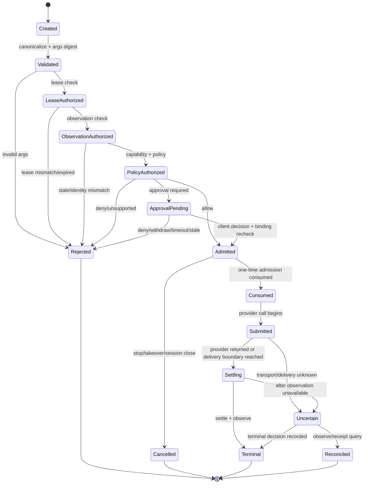

# SP-257 — ActionContext 与 Action Admission P0 设计

## 1. 设计摘要

TritonKit 当前已经拥有 target lease、requestID、provider receipt、stale/uncertain recovery、postcondition 和 evidence manifest，但它们由不同 runner、host adapter、CLI gate 和 evidence writer 分别持有。一次动作缺少一个跨边界的身份对象，导致以下事实可能分散：

- 当前动作针对哪个 target；
- 使用哪个 lease 和 owner；
- 基于哪次 observation/selection；
- 请求参数是否被替换；
- provider 是否收到动作；
- stop/timeout 是否覆盖了原始结果；
- evidence 是否真正绑定到这次动作。

本设计引入 provider-neutral 的 **ActionContext** 和 **Action Admission** 概念：

- `ActionContext` 是动作全生命周期的身份与事实快照；
- `Action Admission` 是 provider 发生副作用前的一次有界、可验证、可消费的准入；
- receipt 保存原始 delivery/outcome/postcondition；
- evidence 只引用 context、receipt、observation 和 artifact，不把 UI 文本或敏感参数当授权事实。

P0 只冻结契约和离线验证，不实现新的审批 UI 或新的设备 provider。

## 2. 当前基础与差距

### 2.1 已有能力

静态核对当前代码：

- [`TKTargetLeaseModels.swift`](../../../../Sources/TritonKitShared/TKTargetLeaseModels.swift) 已定义 opaque lease id、normalized target、owner、TTL、expiresAt 和 read-only observation 标记；
- [`CLITargetLeaseStore.swift`](../../../../Sources/TritonKitCLI/CLITargetLeaseStore.swift) 已提供线程安全 acquire/release/takeover/check，测试可以注入 `now`；
- [`TKCLITransportSchemaModels.swift`](../../../../Sources/TritonKitShared/TKCLITransportSchemaModels.swift) 已把 delivered/uncertain action 指向 observe/receipt 恢复，并禁止 automatic replay；
- [`TKEvidenceModels.swift`](../../../../Sources/TritonKitShared/TKEvidenceModels.swift) 已支持 target、artifacts、skipped、run、screen workspace、freshness、partial/error；
- [`TKEvidenceRunModels.swift`](../../../../Sources/TritonKitShared/TKEvidenceRunModels.swift) 已记录 run、step、tool、target、observation、intent、status、verdict、artifactRefs；
- runner/host action 已存在 requestID、nonce、observation identity、postcondition 和 durable receipt 的局部实现。

### 2.2 P0 需要补齐的关联

1. lease、requestID、observation、receipt 和 evidence 需要共享 `actionID`；
2. 参数需要规范化后产生一个不可见的 canonical digest；
3. provider admission 需要绑定 context digest，避免 lease check 之后换 target/参数；
4. delivery、outcome、postcondition 需要分开表达；
5. terminal rewrite 需要保留 original status；
6. run event 需要能引用 context/receipt/approval/observation/artifacts。

## 3. 核心对象

### 3.1 ActionContext

以下是 wire 语义草图。字段名称可以在实现时按现有 Swift 命名规范调整，但语义必须保持：

```text
TKActionContext {
  schemaVersion: Int
  actionID: String
  runID: String?
  stepID: String?
  sessionID: String?

  target: String
  targetIdentity: String?
  operation: String
  provider: String?
  environmentID: String?

  leaseID: String?
  leaseOwner: String?
  leaseExpiresAt: String?

  argsDigest: String
  argsDigestAlgorithm: sha256 | hmac_sha256
  argsCanonicalizationVersion: String
  argsRedactionProfile: String

  observationID: String?
  observationRevision: String?
  runtimeInstanceID: String?
  coordinateSpace: String?
  observationCapturedAt: String?

  policyDecision: allow | deny | approval_required | unsupported | unavailable
  approvalID: String?
  approvalBindingDigest: String?

  admissionID: String?
  createdAt: String
}
```

#### 参数摘要规则

- 不保存原始敏感参数；
- canonicalization 必须稳定处理字段顺序、默认值、坐标和 Unicode；
- 公共低敏感参数可以使用 SHA-256；
- credential、文本输入、token、路径等低熵或敏感参数优先使用进程/服务持有的 HMAC-SHA256；
- digest 中必须包含 canonicalization version 和 redaction profile，避免版本升级后误判相同；
- 只要 operation、target、lease 或 digest 任一变化，就不能复用 approval/admission。

### 3.2 ActionAdmission

`ActionAdmission` 是 provider 副作用前的短期准入凭证，不等于 lease，也不等于 receipt：

```text
TKActionAdmission {
  admissionID: String
  actionID: String
  contextDigest: String
  target: String
  leaseID: String?
  owner: String?
  state: issued | consumed | cancelled | expired
  issuedAt: String
  expiresAt: String
  consumedAt: String?
}
```

约束：

- admission 只绑定一个 action context；
- admission 有短 TTL，建议初始 30 秒，具体值由实现切片冻结；
- admission 最多消费一次；
- target/lease/context digest 不匹配时拒绝消费；
- action 被 Stop、takeover、cancel、session close 或 lease expiry 影响时取消 admission；
- admission consumed 只表示 provider 被允许提交，不表示业务成功。

当前实现可以先在同一 CLI/runner 进程内以纯内存 fixture 验证，之后再决定是否由 `triton serve` 作为共享状态持有者提供 HTTP endpoint。

### 3.3 ActionReceipt

```text
TKActionReceipt {
  schemaVersion: Int
  actionID: String
  admissionID: String?
  requestID: String?
  target: String
  leaseID: String?

  startedAt: String
  submittedAt: String?
  endedAt: String?
  settledAt: String?

  delivery: not_started | submitted | delivered | unknown
  outcome: pending | settled | uncertain | stale | blocked | cancelled | stopped | failed
  executed: true | false | unknown
  originalStatus: String?
  terminalStatus: String?

  settle: not_requested | settled | timeout | unavailable
  postcondition: not_requested | verified | unverified | failed | unavailable
  postconditionEvidenceRefs: [String]

  observationBeforeID: String?
  observationAfterID: String?
  evidenceRefs: [String]
  errorCode: String?
  recoveryCommands: [String]
}
```

`executed` 不能从 `outcome` 反推：

| 场景 | delivery | outcome | executed |
| --- | --- | --- | --- |
| admission 被拒绝 | not_started | blocked/stale | false |
| provider 明确拒绝且未提交 | not_started | failed | false |
| provider 已确认提交并成功返回 | delivered | settled | true |
| transport 超时、可能已提交 | unknown | uncertain | unknown |
| stop 在 provider 已提交后到达 | delivered/unknown | stopped | true/unknown |

### 3.4 Evidence 关联

不新增第二套 evidence 真相源。`TKEvidenceManifest` 和 run/events 继续作为事实出口，新增字段或 metadata 时只补关联：

```text
runID
 └─ actionID
     ├─ contextDigest
     ├─ target / lease / owner
     ├─ requestID / admissionID / approvalID
     ├─ observationBeforeID / observationAfterID
     ├─ receiptID
     ├─ beforeArtifactRefs
     ├─ afterArtifactRefs
     └─ postconditionArtifactRefs
```

证据约束：

- screenshot 没有 target identity 时只能标 identity incomplete；
- postcondition observation 必须与 action target/runtime instance 相同；
- evidence 写入失败不能改写 provider receipt；
- raw screen text、credential、token 和路径遵循现有 redaction policy；
- queued/written/partial/unavailable 等持久化阶段要显式表达。

## 4. Admission 状态机

### 4.1 动作阶段



### 4.2 不变量

1. `Created` 之后必须有 actionID 和 argsDigest；
2. provider 调用前必须通过 lease/target/observation/capability/policy/admission；
3. approval decision 必须重新验证 binding 和 observation；
4. admission 只能消费一次；
5. provider 调用开始后，任何不确定结果不能自动重放；
6. Stop/takeover 可以改变 terminalStatus，但不能删除 originalStatus/delivery；
7. evidence 不得反向改变 action receipt；
8. read-only observation 可以不持有 lease，但不得获得 mutating admission；
9. target alias 归一化必须在 lease check、args digest 和 receipt 中使用同一结果；
10. 所有跨进程/跨 runner 的 context/receipt 都必须带 schemaVersion。

## 5. 固定门禁顺序

```text
1. Resolve target identity
2. Normalize target key
3. Canonicalize arguments
4. Create actionID + argsDigest
5. Resolve session/owner
6. Check lease (if action requires lease)
7. Validate observation/runtime identity (if action uses selection/coordinates)
8. Check capability/readiness/preconditions
9. Evaluate policy/scope/read-only
10. Check or create approval binding
11. Issue short-lived admission
12. Acquire provider/target action lock
13. Re-check lease, admission, observation and stop barrier
14. Consume admission once
15. Submit provider action
16. Record delivery boundary and receipt
17. Settle/observe within bounded budget
18. Verify postcondition if requested
19. Persist evidence refs and final terminal status
```

第 13 步是 Pinky 二次 gate 在 TritonKit 的对应物，必须在 provider lock 下执行。第 17 步不能把 settle timeout 当作业务成功。第 19 步不能阻塞动作 receipt 的返回；证据持久化失败要单独标记。

## 6. 错误和兼容规则

### 6.1 优先复用现有错误

| 场景 | 现有/建议代码 | 行为 |
| --- | --- | --- |
| 目标租约冲突 | `target_lease_conflict` | 保留 current owner/lease/expiry，不调用 provider |
| 选择或 observation 过期 | `selection_stale` / `device_action_observation_stale` | 返回 refresh/observe 建议，不猜坐标 |
| 目标 identity 不一致 | 现有 identity mismatch 类错误 | 保留 expected/observed 摘要 |
| 送达未知 | `outcome_unknown` 或现有 uncertain 类错误 | receipt 保留 delivery unknown，禁止 replay |
| provider 不支持 | 现有 unsupported 类错误 | `executed=false` |
| approval binding 不匹配 | 新增 `approval_binding_mismatch` | provider 调用次数必须为 0 |
| admission 已消费 | 新增 `action_admission_used` | 返回原 actionID/receipt 查询建议 |
| admission 过期 | 新增 `action_admission_expired` | 重新创建 action，不复用旧 admission |
| postcondition 未验证 | 不把它改成 action failed | action receipt 可 settled/delivered，同时 postcondition unverified |

### 6.2 向后兼容

- 无 `--lease` 的既有只读命令行为不变；
- 已明确 opt-in 的 mutating 命令继续使用 `--lease`；
- P0 先在已有 requestID/receipt 的 runner/host action 上试点，不一次性改所有 CLI；
- 新字段全部 optional，旧 JSON 消费方仍可读取原 envelope；
- 新错误必须保留 `nextAction`/`suggestedCommands`，不能只返回内部实现名；
- 不把没有 approval UI 的 CLI 路径伪装成“已人工批准”。

## 7. P0 实现切片建议

### Slice A：纯模型与 canonical digest

文件面候选：

- `Sources/TritonKitShared/` 新增 ActionContext/Receipt/Admission DTO；
- 复用 `TKTargetLease`、`TKEvidenceRunEvent` 和 `TKCLIErrorDetail`；
- 不新增设备逻辑；
- 用纯 Swift fixture 测试 canonical arguments、target normalization、digest version 和敏感字段不落盘。

### Slice B：Admission Store 与 one-time consume

文件面候选：

- `Sources/TritonKitCLI/` 新增纯状态机 store；
- 所有时间由调用方注入；
- 测试 issued/consumed/cancelled/expired、target mismatch、lease mismatch、duplicate consume、stop barrier；
- 不接真实 server、端口或设备。

### Slice C：一个已有 runner action 试点

候选优先选择已有 requestID、receipt、postcondition 的 action。要求：

- action 创建 context；
- admission 在 provider call 前消费；
- 原始 receipt 写入 context/actionID；
- uncertain 不 replay；
- run event 引用 actionID/receipt/evidence；
- 旧无 lease 路径行为保持兼容。

### Slice D：BDD 与回归

必须加入并发和负例 fixture：

- lease target mismatch；
- approval args mismatch；
- stale observation；
- approval pending + observe 并发；
- Stop/takeover 在 admission 前后；
- provider submitted 后 timeout；
- duplicate requestID/actionID；
- evidence write failure；
- late provider result 不污染新 action generation。

## 8. BDD 验收清单

1. **Lease 冲突**：owner-1 持有 target A，owner-2 action 返回 `target_lease_conflict`，provider call count 为 0。
2. **Lease 目标变更**：lease token 属于 target A，request 指向 target B，返回 conflict，不产生 admission。
3. **参数替换**：approval 为 args digest X，重放 digest Y，返回 `approval_binding_mismatch`，原 approval 保持 open/withdrawn 状态。
4. **Observation 过期**：旧 selection/runtime instance 执行 action，返回 stale，provider call count 为 0。
5. **二次 gate**：第一 gate 通过后 takeover/stop，provider lock 下第二 gate 拒绝 action。
6. **Approval 并发**：两调用使用同 approval，最多一个 admission consumed 和 provider call。
7. **送达未知**：provider 返回 timeout/drop，receipt 为 delivery unknown + outcome uncertain + executed unknown；没有自动 replay。
8. **Stop race**：provider 已提交后 Stop 到达，terminalStatus=stopped，但 originalStatus/delivery 保留。
9. **Settle timeout**：transport success、settle timeout，outcome 可为 settled/timeout，但 postcondition=unverified，不宣称业务成功。
10. **Evidence failure**：artifact 写入失败不覆盖 action receipt，manifest 为 partial/error 并保留 receipt ref。
11. **Late result**：旧 generation 的迟到结果不能完成新 action，也不能清理新 lease/admission。
12. **只读隔离**：无 lease 的 observe 可以执行，无 lease 的 mutating action 没有 admission。

## 9. 设计风险

- **参数摘要风险**：低熵敏感参数不应直接 SHA；优先 HMAC，且不保存原文。
- **时间风险**：所有 TTL、approval deadline、admission expiry 和 settle budget 要可注入，避免 wall clock 测试漂移。
- **终态覆盖风险**：terminalStatus 不能替代 originalStatus；停止不证明动作未送达。
- **证据阻塞风险**：receipt 返回不能依赖截图/录屏/evidence 写盘成功；写盘失败要异步或 partial 记录。
- **身份风险**：User-Agent、显示名称和 path alias 不是强身份；owner/session 必须有明确来源。
- **范围风险**：ActionContext 不能顺势变成远程 Agent、真机、云设备或 Wails 写控制面。

## 10. 设计决策

| 决策 | 结论 | 原因 |
| --- | --- | --- |
| 采用自由文本结果 | 否 | TritonKit 已有 JSON/JSONL/schema/evidence 契约 |
| 复制 Pinky SQLite history | 否 | 现有 evidence/run 已是事实源，先补关联 |
| P0 立刻实现审批 UI | 否 | 当前只冻结 approval binding，避免扩大控制面 |
| admission 是否等于 lease | 否 | lease 是长期所有权，admission 是短期一次性准入 |
| receipt 是否等于 postcondition | 否 | provider 回执和业务验证是不同事实 |
| uncertain 是否自动 replay | 否 | delivery 可能已发生，必须 observe/reconcile |
| 无 lease 是否拒绝所有 action | 暂不 | 保留既有 opt-in 兼容，逐切片推进 |
| 真实手机 Companion 是否进入 P0 | 否 | 超出当前 Simulator/Emulator/host adapter 边界 |

## 12. P0 第一切片实现状态

已落地纯离线 shared model/store：

- `Sources/TritonKitShared/TKActionContextModels.swift`
  - `TKActionArgumentsDigest`：sorted-key canonical JSON；SHA-256/HMAC-SHA256；版本化 canonicalization 和 redaction metadata；
  - `TKActionContext`：action/session/target/lease/observation/policy/approval identity 与 schema validation；
  - `TKActionAdmission`：issued/consumed/cancelled/expired state；
  - `TKActionAdmissionStore`：注入时间、TTL 边界、binding mismatch、duplicate admissionID、cancel/expiry、线程安全 one-time consume。
- `Tests/TritonKitSharedTests/TKActionContextModelsTests.swift`：8 项 focused tests，覆盖 digest、schema、binding、expiry、cancel 和 32 路并发 single-use。

验证结果：root package `swift test --no-parallel` 通过，302 tests / 43 suites；P0 focused suite 8/8 通过；CLI package `swift test --package-path CLI --no-parallel` 通过，1680 tests / 179 suites。

## 13. P0 第二切片实现状态

已将 admission 接入已有 `device.platform-control` iOS host XCTest runner：

- exact Simulator target inventory 通过后才签发 admission；
- admission 绑定 ActionContext 的 actionID、contextDigest、normalized target 和 lease（当前 runner 无 lease，显式记录 nil）；
- admission 在 xcodebuild 启动前一次性 consume；
- runner receipt 增加 actionID、admissionID、contextDigest、delivery、originalStatus、terminalStatus；
- success 路径输出 `delivery=delivered`；timeout/unknown 路径输出 `delivery=unknown` 并保持原始 outcome；
- target unavailable 路径不签发 admission、不中途调用 runner；
- 既有 exact runtime family、nonce、postcondition、result bundle 和 durable audit 检查保持。

测试：`swift test --package-path CLI --no-parallel --filter ApplePlatformRunnerTests` 通过 12/12；root 302 tests / 43 suites 和 CLI 全量 1680 tests / 179 suites 已在本切片前后通过。

第二切片仍未接入其他 mutating action、HTTP admission endpoint、approval UI、session resume 或 evidence manifest event 关联。下一切片优先把 receipt metadata 映射到 run event/evidence refs，并补 provider admission 失败与 late result generation fixture。

## 14. P0 第三切片与 C 阶段实现状态

已完成 receipt 到 evidence event 的 typed projection、late-result generation guard 和正式 evidence writer 接线：

- `TKActionEvidenceMetadata` 加入 `TKEvidenceRunEvent.actionContext`，旧 JSON 无该字段时保持兼容；
- runner receipt 可投影为 actionID/admissionID/contextDigest/delivery/outcome/executed/originalStatus/terminalStatus/postcondition/evidenceRefs；
- `TKActionGenerationStore` 按 normalized target 生成递增 token，旧 generation、不同 actionID 和 invalidate 后的迟到结果均拒绝；
- `device platform-control --evidence-dir <dir>` action 前写 run_started/step_started/tool_call；
- receipt 写入 `run/action-receipt.json`；
- tool_result/step_completed/run_completed 携带 actionContext；
- evidence 写入失败保留 action receipt，并标记 `evidencePersistence=failed`；
- evidence refs 使用相对路径，不公开 runner 私有绝对路径；
- platform-control parent/subcommand schema 已公开 evidence-dir 和 receipt metadata；
- 旧无 evidence-dir 行为与旧 JSON 兼容。

测试：shared metadata/generation focused 17 项；Apple runner 13/13；EvidenceBundle 25；schema focused 52 项；root 302 tests / 43 suites；CLI 1680 tests / 179 suites。

## 15. D 阶段 lease-aware admission

已完成 runner 的可选 lease 接线：

- `HostApplePlatformRunnerRequest.leaseID` 可选，旧调用默认 nil；
- CLI `device platform-control` 支持 `--lease`、复用现有 `enforceTargetLease` server 原子 check；
- lease check 在 target inventory 通过后、admission 签发前执行；
- ActionContext contextDigest 绑定 leaseID；
- lease gate 拒绝时不签发/消费 admission，不调用 runner；
- 无 lease 仍保持既有兼容路径；
- device parent/subcommand schema 已登记 lease 选项。

验证：Apple runner focused 15/15；Apple control/schema focused 59 项；CLI 全量 1680 tests / 179 suites 通过。下一阶段进入 E：将 generation guard 包住 runner 的 timeout/cancel/late callback 生命周期。

## 16. 实现前置条件

实现前必须重新冻结：

- 第二类 mutating action 的准确文件面；
- HTTP/CLI error code、recovery 和 schema 字段；
- generation 与 provider callback 的 owner/session 绑定；
- lease store 与 admission store 锁顺序；
- receipt/evidence queued/written/partial 语义；
- focused tests、root tests、CLI full tests 和 docs gate 清单。

## 17. E 阶段 generation 生命周期

已将 `TKActionGenerationStore` 接入 runner 执行生命周期：

- action 开始时按 normalized target/actionID 创建 generation token；
- provider runner 返回后立即校验 token，旧 generation 返回 `runner_generation_stale`；
- attachment/result receipt 验证前再次校验 token，避免旧结果发布成功 receipt；
- stale generation 输出 delivery unknown、executed unknown，不自动 replay；
- failure code 已加入 runner schema/recovery 表面；
- 旧 generation 不能污染新 action 的 admission、receipt 或 evidence。

验证：Apple runner focused 16/16；阶段 D 的 control/schema focused 59 项和 CLI full 回归通过。

## 18. F 阶段第二类 mutating action 试点

已开始接入 `device.action` 统一入口：

- `DeviceActionCommonOptions` 增加可选 `--lease`、host、port；
- target resolve 后先执行 server lease gate（显式 lease 时）；
- tap/double-tap/swipe/press/type 统一构造 ActionContext 和 canonical args digest；
- AdmissionStore 在 host command/iOS runner 请求前签发并一次性 consume；
- Android/Harmony/iOS 结果统一补 actionID/admissionID/contextDigest/delivery/outcome/executed/original/terminal/postcondition；
- generation stale 返回 typed `generationStale`，不发布结果；
- text file path 只进入 private redaction digest，不写入公开 action metadata；
- device action schema 已登记 `--lease`。

## 19. G 阶段 schema/recovery contract

已完成 device.action 新状态的机器可读表面：

- `device_action_generation_stale`：诊断/观察/验证，不建议 replay；
- `device_action_result_invalid`：诊断/计划；
- catch 映射不再把 generation stale/result invalid 混成普通 `device_action_invalid`；
- device parent schema failureCodes 已登记新代码；
- recovery taxonomy 与 schema fact-source taxonomy 同步；
- F action 的 `--lease`、context metadata、receipt 字段保持 schema backed。

验证：DeviceActions focused 8 项；Apple control/schema/DeviceActions focused 67 项通过。

## 20. H 阶段并发联合验收

已补联合不变量 fixture：

- admission 并发 consume 只有一个成功；
- generation 旧 token 和 invalidate 后 token fail closed；
- 多线程同 target generation 只保留最大 generation 为 current；
- 不同 normalized target 的 generation 不串扰；
- device.action lease reject 时 host runner call count 为 0；
- device.action 成功 projection 携带 admission/delivery/executed；
- device.action late generation 不发布结果；
- evidence actionContext roundtrip 和旧 JSON compatibility 保持。

当前 H focused：ActionContext 10 项、DeviceActions 8 项、runner 16 项、schema/recovery 67 项已通过；root 304 tests / 43 suites、CLI 1685 tests / 179 suites 全量通过。下一步是 I 文档/最终门禁。

