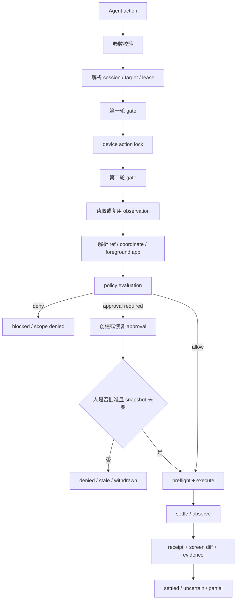

# DIYgod/pinky 深度技术调研报告

**报告编号**：SP-279 / 20261110
**研究对象**：`DIYgod/pinky`  
**来源**：<https://github.com/DIYgod/pinky>  
**固定版本**：`v2026.1109.16` / `209aa9e4b2ff1fd81edec3c393a64b21b79162fb`  
**许可证**：Apache-2.0；LICENSE SHA-256 `c95bae1d1ce0235ecccd3560b772ec1efb97f348a79f0fbe0a634f0c2ccefe2c`  
**研究日期**：2026-11-10（Asia/Shanghai）

## 执行摘要

Pinky 是一个本地优先的 AI Agent 手机操作网关。Agent 通过 MCP 请求连接手机、读取屏幕、执行输入和等待结果；网关统一管理设备 provider、session、lease、policy、approval、settle、history 和证据。桌面端只负责展示、审批、接管和停止，不能被 Agent-facing MCP 工具越权调用。

对 TritonKit 最有价值的技术是 **ActionContext + action admission**：一次动作必须绑定目标、租约、会话、规范化参数摘要、观察版本、策略决定、审批、送达状态、最终结果、后置验证和证据。Pinky 的价值集中在动作边界和失败语义，具体的 MyGo UI、真实手机驱动、Android Companion、FFmpeg、Apple DDI 和 Go 供应链不适合直接移植到当前 TritonKit 的模拟器/host adapter 产品边界。

TritonKit 已经具备 `TKTargetLease`、requestID、provider receipt、stale/uncertain recovery、postcondition、`TKEvidenceManifest` 和 run/events JSONL 等基础。当前最值得补齐的是这些对象之间的统一关联：

```text
ActionContext
  = session
  + target
  + lease
  + canonical arguments digest
  + observation revision
  + policy/approval
  + delivery
  + outcome
  + postcondition
  + evidence
```

建议优先做一个纯离线 P0 合同切片：统一 ActionContext、审批绑定、二次 admission gate、`delivery/outcome/postcondition` 三分法，以及 uncertain/stale/禁止自动 replay 的负例。它能覆盖 iOS、Android、HarmonyOS、CLI、HTTP 和 evidence，而不需要引入新设备或新的 Web 控制面。

## 1. 研究方法与证据等级

本报告基于固定版本本地 clone 的源码和项目文档静态读取。未运行 Pinky、Go/Kotlin/Gradle/Docker 构建、第三方依赖、MCP 服务、真实设备、模拟器或网络测试。

结论按以下证据等级解释：

| 等级 | 含义 |
| --- | --- |
| S1 源码观察 | 由固定提交中的实现、类型、状态迁移或测试直接支持 |
| S2 项目文档 | README、DESIGN、MCP、ACCEPTANCE、RELEASING 等上游文档声明；不等于本地复验 |
| S3 静态推断 | 根据代码结构推断的架构关系、风险或迁移方向 |
| S4 未验证 | 需要真实构建、设备、签名、网络或发布流程才能确认 |

本报告中的“Pinky 已实现”主要指 S1；“Pinky 支持/已验证”若只来自 README 或 ACCEPTANCE，则保留 S2/S4 边界。

## 2. 项目架构

### 2.1 模块分层

| 层 | 关键路径 | 责任 |
| --- | --- | --- |
| 入口和桌面 | `cmd/pinky/`、`ui/` | app、daemon、MCP stdio、设备列表、token、update、原生 MyGo UI |
| 网关 | `internal/gateway/` | session、device、lease、动作管线、停止、接管、settle、历史写入 |
| MCP/HTTP | `internal/mcp/`、`internal/api/` | 14 个 phone 工具、stdio shim、Streamable HTTP、sessionless 兼容、上传链接 |
| 策略/审批 | `internal/policy/`、`internal/approval/` | scope、read-only、blocked app、credential、Ask/Deny/Allow 和人工决策状态机 |
| provider/driver | `internal/driver/android/`、`internal/driver/ios/` | Android adb/scrcpy/Companion；iOS CoreDevice/WDA/usbmuxd |
| screen/video | `internal/screen/`、`internal/video/` | 统一节点、坐标、OCR、事件、diff、settle、视频 packet/player |
| history | `internal/history/` | SQLite、媒体、录屏、任务步骤和审批索引 |
| Android Companion | `android/companion/`、`internal/driver/android/companion/` | 无障碍树、事件、文本输入和 idle 等加速能力 |
| telemetry/update | `internal/telemetry/`、`internal/update/` | 匿名统计、crash journal、更新下载、校验、swap、回滚 |

### 2.2 Provider 与 Gateway 解耦

`internal/driver/driver.go` 明确规定 gateway 不按平台分支，而是使用 `Provider`、`Device` 和可选能力接口：

```text
Provider
  ├─ Platform()
  ├─ List(ctx) -> []Info
  └─ Open(ctx, id) -> Device

Device
  ├─ Observe / Screenshot
  ├─ Tap / Swipe / Type / Key / Launch
  ├─ Apps / Stream
  └─ Close
```

设备信息统一表示稳定 ID、平台、连接方式、backend、online/offline/unauthorized/needs_setup 和 setup code；额外能力通过接口断言扩展，例如 `Settler`、`LockReporter`、`Backgrounder`、`CompanionInstaller`、`Unlocker` 等。

这对 TritonKit 的直接启发是：上层只处理 target identity、readiness、capability、lease 和动作语义，平台差异留在 iOS Simulator、Android Emulator、Harmony Emulator 或 host adapter 内部。Pinky 的真实手机 provider 不应直接接入当前产品主链。

## 3. 动作状态机

### 3.1 主流程

Pinky 的动作管线由 `internal/gateway/pipeline.go` 实现，关键顺序如下：



关键源码位置：

- `internal/gateway/pipeline.go:203-216`：`Session.Act` 获取 lease、合并 context、调用 gateway 并统一 finish；
- `internal/gateway/pipeline.go:218-275`：设备状态、用户接管、approval busy、锁定和 scope gate；
- `internal/gateway/pipeline.go:341-413`：动作主流程以及 action lock 下的二次 gate；
- `internal/gateway/pipeline.go:473-511`：目标及命中区域的 policy 评估；
- `internal/gateway/pipeline.go:623-761`：ref、坐标、App、scope、read-only 和 credential 解析。

### 3.2 为什么要二次 gate

第一次 gate 到真正执行之间可能发生：

- 用户接管设备；
- lease 被停止或过期；
- 另一个调用打开 approval；
- 设备进入 locked/offline/setup 状态；
- 当前 observation 已过期。

因此 Pinky 在设备 action lock 下再次检查 gate，审批恢复时还会重新读取并比较 App、target role/label/bounds/states、point 和屏幕文本。任一事实变化都返回 `stale`，不会用旧审批继续执行。

这比单纯的“检查 lease → 调用 provider”更强，适合转化为 TritonKit 的统一 action admission contract。

### 3.3 Delivery、Outcome、Postcondition

Pinky 的结果语义隐含区分了三个层面：

```text
delivery       动作是否送到 host/provider/设备
action outcome 调用是否得到稳定可解释结果
postcondition  UI/业务状态是否被独立观察确认
```

典型状态：

```text
送达未知 + 返回超时 + 未完成观察
= delivery=unknown, outcome=uncertain, postcondition=unverified
```

TritonKit 应把它们写入 receipt/evidence，而不是只输出一个 `ok=false`：

```text
executed: true | false | unknown
originalStatus
terminalStatus
postcondition: verified | unverified | failed | unavailable
```

## 4. Session、Lease、Stop 与 Resume

### 4.1 Session 与 lease 不是同一身份

Pinky 一个 MCP session 映射一个 gateway session。普通 session 关闭会结束 lease；明确允许 resume 的 remote agent 例外：

- 旧 session 关闭时 lease 在 `ResumeGrace` 内保留；
- 新 session 只有同一 Agent、更新的 session sequence、旧 lease 空闲时才可 adopt；
- 旧 session 有 in-flight call 时，新 session 得到 `lease_held`；
- approval binding 会重新绑定到新 session；
- Stop 会写入 inherited stop hold，阻止新 session 立即绕过停止。

源码：`internal/gateway/agent.go:248-279`、`internal/gateway/resume.go:11-176`。

TritonKit 如果未来支持远程 Agent，至少需要分别建模：

```text
lease owner identity
session identity
resume policy
inflight state
stop barrier
resume grace
```

本地 CLI 不应默认继承旧 lease；User-Agent 或客户端显示名称不能作为强身份。

### 4.2 Stop 与 takeover 的终态处理

Pinky 的控制面可以 takeover、hand back 或 stop：

- takeover 取消 inflight，撤回普通 approval，后续 Agent action 首次返回 `user_took_over`，之后返回 `paused`；
- hand back 恢复任务或完成 handoff approval；
- stop 结束 lease、取消 context、撤回 approval、阻止同一任务继续；如果动作已可能送达，结果会提示可能已经发生。

TritonKit 要保留原始 provider 结果和最终控制面终态，避免将 `settled/uncertain` 直接覆写成 `stopped` 后丢失事实。

## 5. Approval 与 Policy

### 5.1 Approval 状态机

```text
Open
  ├─ Decide → Decided → Wait consumes → Used
  ├─ timeout → Decided(Deny)
  ├─ Withdraw → Withdrawn
  └─ session/stop/gateway teardown → Withdrawn
```

Approval binding 包含：

```text
session + device + lease + tool + canonical args digest
```

`internal/approval/approval.go:321-330` 的 `Check` 会比较完整 binding；参数、设备、工具、lease 或 session 变化都不能复用 approval id。MCP server 只暴露 Agent-facing 方法，approve/stop/takeover 仅由 client API 执行。

### 5.2 Policy 评估顺序

`internal/policy/engine.go:143-235` 的顺序大致是：

1. credential/password/code 字段直接 Deny；
2. Agent scope 和 task app list；
3. blocked app；
4. 动作类别规则按严格度合并；
5. read-only 收紧 Ask 和输入范围；
6. Always allow 只解除 Ask，不能解除 Deny 或 read-only。

Pinky 还会对手指落点下的外层元素和 OCR 文本再次评估，因此点击价格文本、Pay 外层按钮或 Canvas/OCR 文本都可能触发更严格策略。

TritonKit 可借鉴策略顺序和“控制面决策、Agent 只能等待”的权责分离，但继续使用 TritonKit 的 schema-backed JSON envelope。

## 6. Screen、Ref、OCR 与 Settle

### 6.1 Screen 是动作事实

Pinky `internal/screen/screen.go` 的 screen 包含：

- pixel coordinate space；
- foreground App、orientation、keyboard、lock；
- tree/OCR source；
- stable ref、resource ID、ancestry path；
- focused/editable/password 等状态；
- transient events；
- captured time。

ref 不等于永久坐标。动作必须基于某份 observation 解析 ref；若 ref、bounds、App 或 screen revision 不再匹配，只能返回 stale/not_found。

### 6.2 Settle 不是成功证明

Pinky 允许动作调用在 settle budget 到期时返回，但结果应表明画面未稳定。下一动作会等待前一步欠下的 settle 时间，避免连续 batch 读取到旧屏幕。

TritonKit 当前已经有 selection revision、runtime instance、visual stability、stale/uncertain recovery 等能力。下一步建议统一：

```text
ObservationIdentity {
  target
  runtimeInstance
  capturedAt
  revision
  source
  hierarchyState
  coordinateSpace
}

ActionTiming {
  startedAt
  submittedAt
  settledAt?
  settleBudgetMs
  observationFreshUntil?
  visualStable: true | false | unknown
}
```

## 7. Android Companion 与 Provider 能力边界

Pinky Companion 的正确借鉴方式是“可选性能加速器”：

- gateway 仍拥有 policy、scope、approval 和 evidence；
- Companion 提供更快的树、事件、idle 和文本输入；
- 抽象 Unix socket 只接受 shell/root/自身 UID；
- 请求有协议版本、feature negotiation、maxNodes、timeout 和单线程 tree worker；
- 服务缺失或版本旧时回退到 adb/uiautomator。

这对 TritonKit 的启发是把能力拆开：

```text
readable_background_display
screenshot_from_stream_only
input_ready
settle_supported
ocr_supported
companion_accelerated
```

不能因为 virtual display 能创建就推断它可读、可截图或可输入。真实手机 Companion、无障碍服务、adb forward 和签名安装都超出当前 TritonKit 模拟器/host adapter 边界，若未来需要必须另建 space。

## 8. MCP/HTTP 与权限边界

Pinky 有清晰的控制面/执行面分离：

- Agent-facing tool：connect、observe、action、wait、release；
- client/control plane：approve、stop、takeover、handback；
- session 关闭：撤回 approval、结束或按策略保留 lease；
- remote agent：独立 scope，不继承本机同名 Agent 的授权；
- token、MCP session id、upload token 具有不同生命周期。

HTTP 还包含 Bearer token、constant-time compare、CrossOriginProtection、DNS rebinding 防护、session timeout 和一次性上传链接。Pinky 的 User-Agent sessionless 兼容便于接入，但不能作为强身份模型。

TritonKit 应借鉴语义，继续保留 JSON/JSONL/schema/evidence 契约。建议所有动作证据能够关联：

```text
sessionID
requestID
actionID
leaseID
approvalID
observationID
receiptID
```

## 9. History、Privacy 与 Evidence

Pinky history 使用 SQLite + media/recordings 目录，step 记录 tool、args、intent、status、before/after media、target geometry；approval 记录 rule、decision、note 和 wait duration；媒体保存 size/hash，blocked app 不进入 history。

借鉴方式：

- evidence 不只是文件列表，还要包含任务/步骤/动作索引；
- approval 是一等审计对象；
- before/after media 和 action result 共享 step/action identity；
- blocked/credential-sensitive 内容在进入 evidence 前过滤；
- row/file 清理采用两阶段语义，扫描失败时保守保留未知内容。

TritonKit 已有 `TKEvidenceManifest`、`run/events.jsonl`、`screenWorkspace`、target/freshness/partial/error 等字段，因此应扩展关联关系，而不是引入第二套持久化真相。

## 10. 供应链与许可证审查

Pinky 主体是 Apache-2.0，但以下依赖不能由主体许可证覆盖：

- go-ios replacement fork；
- MyGo、MCP SDK、gVisor、modernc SQLite、purego 等 Go 依赖；
- FFmpeg LGPL shared 构建；
- adb 静态依赖中的 AOSP、BoringSSL、libusb、protobuf、Brotli、LZ4、Zstd、zlib；
- Gradle、AGP、Android SDK/JDK；
- Apple CoreDevice/WDA、Developer Disk Image、Xcode SDK 和第三方镜像；
- Docker base image、GitHub Actions 和外部下载源。

可借鉴的供应链机制：版本/SHA 固定、包内 NOTICE/BUILD 信息、构建后自测、manifest 最后发布、临时下载文件、size/hash/stall 校验、atomic swap 和失败回滚。

需要避免的误区：HTTPS + SHA-256 只能证明下载内容符合 feed 声明，不能证明 feed 发布者可信。自动更新还需要签名 manifest、可信公钥、SBOM、provenance 和 rollback receipt。

TritonKit 当前不应复制 Pinky 的 Go/FFmpeg/adb 构建链；只吸收 release manifest、产物自测、checksum、供应链 provenance 和许可证清单思路。

## 11. TritonKit 当前基座和差距

当前代码已经具备：

- `TKTargetLease`：opaque lease id、normalized target、owner、TTL、expiresAt、read-only observation 标记；
- `CLITargetLeaseStore`：acquire/release/takeover/check 的线程安全状态机和可注入时间；
- recovery taxonomy：uncertain action 通过 observe/receipt 恢复，禁止 automatic replay；
- `TKEvidenceManifest`：target、artifacts、skipped、run、screen workspace、freshness、partial/error；
- runner/host action：requestID、nonce、observation identity、postcondition、durable receipt 等局部能力；
- stale selection、target mismatch、device action observation stale、execution uncertain 等错误语义。

主要差距：

1. lease、requestID、observation、receipt 和 evidence 尚未形成统一 ActionContext；
2. approval binding 尚未统一覆盖 target、session、lease、operation 和 canonical args digest；
3. Stop/timeout/late result 可能需要同时保留 originalStatus 和 terminalStatus；
4. observation revision、coordinate space、settledAt、freshness window 尚未成为所有 provider 的共同合同；
5. action、approval、before/after artifact、postcondition 的引用关系还需要机器可验证。

## 12. 建议立项与 BDD

### P0：ActionContext 与 admission contract

建议流程：

```text
normalize target
→ resolve lease
→ validate observation identity
→ canonicalize arguments
→ compute args digest
→ policy/scope check
→ approval check/create
→ provider admission
→ receipt
```

必须覆盖：

- approval id 携带修改后的参数时返回 `approval_mismatch`，provider 调用次数为 0；
- lease 属于 target A、请求指向 target B 时返回 `target_lease_conflict`，无 host mutation；
- 旧 node/coordinate 对应过期 observation 时返回 `observation_stale`；
- approval 等待期间用户接管时返回 `user_took_over`/`paused`；
- provider timeout 且送达未知时返回 `uncertain`，持久化 receipt，禁止自动 replay；
- 两个并发调用使用同一 approval id 时最多一个执行，另一个得到 approval used/duplicate；
- Stop、session close、cancel 撤回 pending approval 并留下终态原因。

### P1：Receipt 与 evidence 强关联

建议关联链：

```text
runID
 └─ actionID
     ├─ sessionID
     ├─ target
     ├─ leaseID
     ├─ observationID
     ├─ requestID
     ├─ approvalID
     ├─ provider receipt
     ├─ before artifact
     ├─ after artifact
     └─ postcondition verification
```

必须覆盖：

- uncertain 导出时 manifest 保留 uncertainty reason 和 observe/verify 建议；
- 只有截图没有 target identity 时标记 identity incomplete，不宣称已验证；
- postcondition 属于不同 target/runtime 时 fail closed；
- 中途停止时已开始动作保留 delivery 状态，后续步骤标记 skipped/stopped；
- evidence 写入失败不覆盖原始 action verdict，manifest 明确 partial/error。

### P2：Observation revision 与 settle contract

必须覆盖：

- batch 在 fresh window 内复用 after observation，并记录复用关系；
- runtime instance 变化后旧 selection 只能返回 stale；
- transport success 但视觉未稳定时允许 delivery=delivered，postcondition 仍是 unverified；
- settle budget 用尽时返回 visual motion timeout 或等价状态，不把最后一帧视为业务成功。

### P3：可选加速 provider

只在当前 provider 性能成为明确瓶颈后评估。Companion、真实手机、后台 display 和新视频链路必须另建 scope，不能由本报告自动扩大产品边界。

## 13. 明确不采用

- MyGo 原生桌面 UI；
- Pinky 的真实手机安装/权限/签名体系；
- adb/scrcpy/Companion/CoreDevice/WDA/Apple DDI/FFmpeg 直接移植；
- Pinky 的自由文本 Agent 输出；
- User-Agent 作为远程 Agent 强身份；
- 把同用户权限下的 gateway 当作 OS sandbox；
- 把 OCR 文本当作 target identity 或业务成功事实；
- 自动继承所有旧 session/lease；
- 复制 Pinky 的 SQLite history 作为 TritonKit 第二套事实源。

## 14. 最终决策建议

建议采用 **revise-first / P0 offline contract**，而不是立即采用 Pinky 的设备或桌面实现。

第一阶段只冻结 ActionContext、approval binding、二次 admission gate、delivery/outcome/postcondition 和 uncertain/stale/replay 禁止规则；测试使用现有 CLI/HTTP/runner fixture、receipt、run/events 和 evidence manifest。通过后再考虑 P1 的远程 session resume、history view/prune 和签名更新 feed。

本报告只支持技术研究和后续立项，不代表 Pinky 与 TritonKit 的协议兼容、运行时兼容、供应链兼容或许可证自动兼容。

## 附录：主要源码证据

- 网关与动作：`internal/gateway/pipeline.go`、`internal/gateway/agent.go`、`internal/gateway/resume.go`；
- 审批与策略：`internal/approval/approval.go`、`internal/policy/engine.go`；
- MCP/HTTP：`internal/mcp/server.go`、`internal/mcp/http.go`、`internal/mcp/sessionless.go`、`internal/mcp/upload.go`；
- Provider/screen/video：`internal/driver/driver.go`、`internal/screen/screen.go`、`internal/video/player.go`、Android/iOS driver 子目录；
- History/隐私：`internal/history/history.go`、`media.go`、`prune.go`、`internal/telemetry/`；
- 构建/供应链：`go.mod`、`Makefile`、`scripts/ffmpeg.sh`、`scripts/adb.sh`、`.github/workflows/ci.yml`、`.github/workflows/release.yml`、`docs/RELEASING.md`；
- TritonKit 对照：`Sources/TritonKitShared/TKTargetLeaseModels.swift`、`Sources/TritonKitCLI/CLITargetLeaseStore.swift`、`Sources/TritonKitShared/TKEvidenceModels.swift`、`Sources/TritonKitShared/TKEvidenceRunModels.swift`、`Sources/TritonKitShared/TKCLITransportSchemaModels.swift`。

**研究限制**：未运行 Pinky、Go/Kotlin/Gradle/Docker、第三方依赖、MCP 服务、真实设备、模拟器、网络或发布流程。